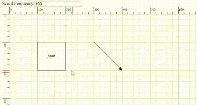

# Scroll Settings in ASP.NET Core Diagram

The diagram can be scrolled by using the vertical and horizontal scrollbars. In addition to the scrollbars, mouse wheel can be used to scroll the diagram. Diagram’s [`scrollSettings`](https://help.syncfusion.com/cr/aspnetcore-js2/Syncfusion.EJ2.Diagrams.DiagramScrollSettings.html) enables to read the current scroll status, view port size, current zoom, and zoom factor. It also allows to scroll the diagram programmatically.

## Get current scroll status

Scroll settings allows to read the scroll status, [`viewPortWidth`](https://help.syncfusion.com/cr/aspnetcore-js2/Syncfusion.EJ2.Diagrams.DiagramScrollSettings.html#Syncfusion_EJ2_Diagrams_DiagramScrollSettings_ViewPortWidth), [`viewPortHeight`](https://help.syncfusion.com/cr/aspnetcore-js2/Syncfusion.EJ2.Diagrams.DiagramScrollSettings.html#Syncfusion_EJ2_Diagrams_DiagramScrollSettings_ViewPortHeight), and [`currentZoom`](https://help.syncfusion.com/cr/aspnetcore-js2/Syncfusion.EJ2.Diagrams.DiagramScrollSettings.html#Syncfusion_EJ2_Diagrams_DiagramScrollSettings_CurrentZoom) with a set of properties. To explore those properties, see [`Scroll Settings`](https://help.syncfusion.com/cr/aspnetcore-js2/Syncfusion.EJ2.Diagrams.DiagramScrollSettings.html).

## Define scroll status

ASP.NET Core Diagram allows to pan the diagram before loading, so that any desired region of a large diagram is made to view. You can programmatically pan the diagram with the [`horizontalOffset`](https://help.syncfusion.com/cr/aspnetcore-js2/Syncfusion.EJ2.Diagrams.DiagramScrollSettings.html#Syncfusion_EJ2_Diagrams_DiagramScrollSettings_HorizontalOffset) and [`verticalOffset`](https://help.syncfusion.com/cr/aspnetcore-js2/Syncfusion.EJ2.Diagrams.DiagramScrollSettings.html#Syncfusion_EJ2_Diagrams_DiagramScrollSettings_VerticalOffset) properties of scroll settings.

























## Update scroll status

You can programmatically change the scroll offsets at runtime by using the client-side method update.

























```javascript
var diagram = document.getElementById("container").ej2_instances[0];
//Updates scroll settings
diagram.scrollSettings.horizontalOffset=200;
diagram.scrollSettings.verticalOffset=30
diagram.dataBind();

```

## AutoScroll

Autoscroll feature automatically scrolls the diagram, whenever the node or connector is moved beyond the boundary of the diagram. So that, it is always visible during dragging, resizing, and multiple selection operations. Autoscroll is automatically triggered when any one of the following is done towards the edges of the diagram.

* Node dragging, resizing
* Connection editing
* Rubber band selection
* Label dragging

The diagram client-side event [`ScrollChange`](https://help.syncfusion.com/cr/aspnetcore-js2/Syncfusion.EJ2.Diagrams.Diagram.html#Syncfusion_EJ2_Diagrams_Diagram_ScrollChange) gets triggered when the autoscroll (scrollbars) is changed and you can do your own customization in this event.

The autoscroll behavior in your diagram can be enabled or disabled by using the [`canAutoScroll`](https://help.syncfusion.com/cr/aspnetcore-js2/Syncfusion.EJ2.Diagrams.DiagramScrollSettings.html#Syncfusion_EJ2_Diagrams_DiagramScrollSettings_CanAutoScroll) property of the diagram.
























## Autoscroll border

The autoscroll border is used to specify the maximum distance between the object and diagram edge to trigger autoscroll. The default value is set as 15 for all sides (left, right, top, and bottom) and it can be changed by using the [`autoScrollBorder`](https://help.syncfusion.com/cr/aspnetcore-js2/Syncfusion.EJ2.Diagrams.DiagramScrollSettings.html#Syncfusion_EJ2_Diagrams_DiagramScrollSettings_AutoScrollBorder) property of page settings.
























## Controlling Autoscroll Speed

You can control how often the scrolling needs to be performed automatically in the ASP.NET Core Diagram component during the auto-scrolling behavior. You can now adjust the frequency, ranging from slow and smooth to quick and rapid, to suit their preferences. To configure, set the value in milliseconds to the [`autoScrollFrequency`](https://help.syncfusion.com/cr/aspnetcore-js2/Syncfusion.EJ2.Diagrams.DiagramScrollSettings.html#Syncfusion_EJ2_Diagrams_DiagramScrollSettings_autoScrollFrequency) property within the scrollSettings class, allowing precise control over how often auto-scrolling occurs. 



## Scroll limit

The scroll limit allows to define the scrollable region of the diagram. It includes the following options:

* Allows to scroll in all directions without any restriction.
* Allows to scroll within the diagram content.
* Allows to scroll within the specified scrollable area.
* The [`scrollLimit`](https://help.syncfusion.com/cr/aspnetcore-js2/Syncfusion.EJ2.Diagrams.DiagramScrollSettings.html#Syncfusion_EJ2_Diagrams_DiagramScrollSettings_ScrollLimit) property of scroll settings helps to limit the scrolling.

The scrollSettings [`scrollableArea`](https://help.syncfusion.com/cr/aspnetcore-js2/Syncfusion.EJ2.Diagrams.DiagramScrollSettings.html#Syncfusion_EJ2_Diagrams_DiagramScrollSettings_ScrollableArea) allows to extend the scrollable region that is based on the scroll limit.

























## Scroll padding

The scroll padding allows to extend the scrollable region that is based on the scroll limit.

























## Scrollable Area

Scrolling beyond any particular rectangular area can be restricted by using the [`scrollableArea`](https://help.syncfusion.com/cr/aspnetcore-js2/Syncfusion.EJ2.Diagrams.DiagramScrollSettings.html#Syncfusion_EJ2_Diagrams_DiagramScrollSettings_ScrollableArea) property of scroll settings. To restrict scrolling beyond any custom region, set the [`scrollLimit`](https://help.syncfusion.com/cr/aspnetcore-js2/Syncfusion.EJ2.Diagrams.DiagramScrollSettings.html#Syncfusion_EJ2_Diagrams_DiagramScrollSettings_ScrollLimit) as “limited”.

























## Restrict Negative Axis

The [`restrictNegativeAxis`](https://help.syncfusion.com/cr/aspnetcore-js2/Syncfusion.EJ2.Diagrams.DiagramScrollSettings.html#Syncfusion_EJ2_Diagrams_DiagramScrollSettings_RestrictNegativeAxis) property of `scrollSettings` limits scrolling and panning to the positive coordinate region (`X >= 0` and `Y >= 0`). It is `false` by default, so users can navigate across both positive and negative coordinates.

N> This property restricts only the viewport. It does not move nodes or connectors placed in negative coordinates, so they can no longer be reached by scrolling or panning. Move them into the positive region before enabling the restriction.

### Toggle at runtime

To change the property at runtime, update it on the diagram instance and call dataBind():

```javascript
//toggle restrictNegativeAxis at runtime
diagram.scrollSettings.restrictNegativeAxis = true;
diagram.dataBind();
```

When enabled, the viewport is immediately limited to the positive coordinate region, which may make diagram elements in negative coordinates inaccessible. If the current view is in the negative region, the viewport resets to the origin (`X = 0`, `Y = 0`). When disabled, users can navigate into negative coordinates again.

The following example places nodes in positive and negative coordinate regions and lets you toggle the restriction.
























### Layout Behavior

If `restrictNegativeAxis` is enabled before a layout is applied, the layout output is shifted into the positive region. The layout’s structure, spacing, orientation, and connector routing are unchanged; only the node positions (`offsetX` and `offsetY`) are shifted.

N> If nodes are manually positioned in negative coordinates before enabling `restrictNegativeAxis`, those nodes are not automatically repositioned and may become inaccessible because the viewport is restricted to the positive coordinate region.

## UpdateViewport

The [`updateViewPort`](../api/diagram) method is used to update the diagram page and view size at runtime.