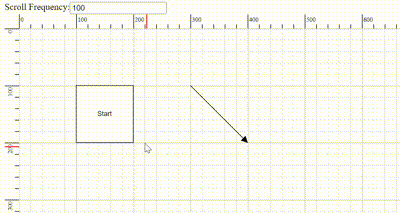

# Scroll Settings in ASP.NET Core Diagram

The diagram can be scrolled by using the vertical and horizontal scrollbars. In addition to the scrollbars, mousewheel can be used to scroll the diagram. Diagram’s [`scrollSettings`](https://help.syncfusion.com/cr/aspnetcore-js2/Syncfusion.EJ2.Diagrams.DiagramScrollSettings.html) enables to read the current scroll status, view port size, current zoom, and zoom factor. It also allows to scroll the diagram programmatically.

## Get current scroll status

Scroll settings allows to read the scroll status, [`viewPortWidth`](https://help.syncfusion.com/cr/aspnetcore-js2/Syncfusion.EJ2.Diagrams.DiagramScrollSettings.html#Syncfusion_EJ2_Diagrams_DiagramScrollSettings_ViewPortWidth), [`viewPortHeight`](https://help.syncfusion.com/cr/aspnetcore-js2/Syncfusion.EJ2.Diagrams.DiagramScrollSettings.html#Syncfusion_EJ2_Diagrams_DiagramScrollSettings_ViewPortHeight), and [`currentZoom`](https://help.syncfusion.com/cr/aspnetcore-js2/Syncfusion.EJ2.Diagrams.DiagramScrollSettings.html#Syncfusion_EJ2_Diagrams_DiagramScrollSettings_CurrentZoom) with a set of properties. To explore those properties, see [`Scroll Settings`](https://help.syncfusion.com/cr/aspnetcore-js2/Syncfusion.EJ2.Diagrams.DiagramScrollSettings.html).

## Define scroll status

ASP.NET Core Diagram allows to pan the diagram before loading, so that any desired region of a large diagram is made to view. You can programmatically pan the diagram with the [`horizontalOffset`](https://help.syncfusion.com/cr/aspnetcore-js2/Syncfusion.EJ2.Diagrams.DiagramScrollSettings.html#Syncfusion_EJ2_Diagrams_DiagramScrollSettings_HorizontalOffset) and [`verticalOffset`](https://help.syncfusion.com/cr/aspnetcore-js2/Syncfusion.EJ2.Diagrams.DiagramScrollSettings.html#Syncfusion_EJ2_Diagrams_DiagramScrollSettings_VerticalOffset) properties of scroll settings.

























## Update scroll status

You can programmatically change the scroll offsets at runtime by using the client-side method update.

























```javascript
var diagram = document.getElementById("container").ej2_instances[0];
//Updates scroll settings
diagram.scrollSettings.horizontalOffset=200;
diagram.scrollSettings.verticalOffset=30
diagram.dataBind();

```

## AutoScroll

Autoscroll feature automatically scrolls the diagram, whenever the node or connector is moved beyond the boundary of the diagram. So that, it is always visible during dragging, resizing, and multiple selection operations. Autoscroll is automatically triggered when any one of the following is done towards the edges of the diagram.

* Node dragging, resizing
* Connection editing
* Rubber band selection
* Label dragging

The diagram client-side event [`ScrollChange`](https://help.syncfusion.com/cr/aspnetcore-js2/Syncfusion.EJ2.Diagrams.Diagram.html#Syncfusion_EJ2_Diagrams_Diagram_ScrollChange) gets triggered when the autoscroll (scrollbars) is changed and you can do your own customization in this event.

The autoscroll behavior in your diagram can be enabled or disabled by using the [`canAutoScroll`](https://help.syncfusion.com/cr/aspnetcore-js2/Syncfusion.EJ2.Diagrams.DiagramScrollSettings.html#Syncfusion_EJ2_Diagrams_DiagramScrollSettings_CanAutoScroll) property of the diagram.
























## Autoscroll border

The autoscroll border is used to specify the maximum distance between the object and diagram edge to trigger autoscroll. The default value is set as 15 for all sides (left, right, top, and bottom) and it can be changed by using the [`autoScrollBorder`](https://help.syncfusion.com/cr/aspnetcore-js2/Syncfusion.EJ2.Diagrams.DiagramScrollSettings.html#Syncfusion_EJ2_Diagrams_DiagramScrollSettings_AutoScrollBorder) property of page settings.
























## Controlling Autoscroll Speed

You can control how often the scrolling needs to be performed automatically in the ASP.NET Core Diagram component during the auto-scrolling behavior. You can now adjust the frequency, ranging from slow and smooth to quick and rapid, to suit their preferences. To configure, set the value in milliseconds to the [`autoScrollFrequency`](https://help.syncfusion.com/cr/aspnetcore-js2/Syncfusion.EJ2.Diagrams.DiagramScrollSettings.html#Syncfusion_EJ2_Diagrams_DiagramScrollSettings_autoScrollFrequency) property within the scrollSettings class, allowing precise control over how often auto-scrolling occurs. 



## Scroll limit

The scroll limit allows to define the scrollable region of the diagram. It includes the following options:

* Allows to scroll in all directions without any restriction.
* Allows to scroll within the diagram content.
* Allows to scroll within the specified scrollable area.
* The [`scrollLimit`](https://help.syncfusion.com/cr/aspnetcore-js2/Syncfusion.EJ2.Diagrams.DiagramScrollSettings.html#Syncfusion_EJ2_Diagrams_DiagramScrollSettings_ScrollLimit) property of scroll settings helps to limit the scrolling.

The scrollSettings [`scrollableArea`](https://help.syncfusion.com/cr/aspnetcore-js2/Syncfusion.EJ2.Diagrams.DiagramScrollSettings.html#Syncfusion_EJ2_Diagrams_DiagramScrollSettings_ScrollableArea) allows to extend the scrollable region that is based on the scroll limit.

























## Scroll padding

The scroll padding allows to extend the scrollable region that is based on the scroll limit.

























## Scrollable Area

Scrolling beyond any particular rectangular area can be restricted by using the [`scrollableArea`](https://help.syncfusion.com/cr/aspnetcore-js2/Syncfusion.EJ2.Diagrams.DiagramScrollSettings.html#Syncfusion_EJ2_Diagrams_DiagramScrollSettings_ScrollableArea) property of scroll settings. To restrict scrolling beyond any custom region, set the [`scrollLimit`](https://help.syncfusion.com/cr/aspnetcore-js2/Syncfusion.EJ2.Diagrams.DiagramScrollSettings.html#Syncfusion_EJ2_Diagrams_DiagramScrollSettings_ScrollLimit) as “limited”.

























## Restrict Negative Axis

The [`restrictNegativeAxis`](https://help.syncfusion.com/cr/aspnetcore-js2/Syncfusion.EJ2.Diagrams.DiagramScrollSettings.html#Syncfusion_EJ2_Diagrams_DiagramScrollSettings_RestrictNegativeAxis) property restricts diagram navigation strictly to the positive coordinate region ($X \ge 0$ and $Y \ge 0$). By default, this property is set to `false`, allowing the diagram to navigate and pan freely across both positive and negative coordinate spaces. When enabled (`true`), users cannot pan or scroll the viewport into negative coordinates.

### Runtime Behavior

The `restrictNegativeAxis` property can be dynamically toggled at runtime by updating `scrollSettings.restrictNegativeAxis` and invoking the `dataBind()` method:

* **When toggled from `false` to `true` (Enabled)**:
  * Viewport navigation is immediately restricted to the positive coordinate region ($X \ge 0, Y \ge 0$).
  * The user cannot pan or scroll into negative coordinates.
  * Manually placed diagram elements positioned at negative coordinates are not automatically moved.
  * Nodes and connectors residing in negative coordinates become hidden or inaccessible because the viewport can no longer navigate into the negative region.

* **When toggled from `true` to `false` (Disabled)**:
  * Viewport navigation restrictions are removed, restoring unrestricted navigation across both positive and negative coordinate regions.
  * Any nodes or connectors located in negative coordinates become accessible and navigable again.

The following example demonstrates how to configure rulers, place nodes in both positive and negative coordinate regions, and toggle the `restrictNegativeAxis` property dynamically at runtime using a CheckBox.
























### Layout Behavior

When `restrictNegativeAxis` is enabled before applying an automatic layout:

* Layout-generated nodes and connectors are automatically translated into the positive coordinate region ($X \ge 0, Y \ge 0$).
* The underlying layout algorithm itself remains unchanged.
* Layout hierarchy, spacing, orientation, alignment, and connector routing are completely preserved.
* The entire layout remains visible and accessible within the positive viewport bounds.

N> If nodes are manually positioned in negative coordinates before enabling `restrictNegativeAxis`, those nodes are not automatically repositioned and may become inaccessible because the viewport is restricted to the positive coordinate region.

### Output Description

* **Unchecked (`restrictNegativeAxis: false`)**: The user can pan and scroll across positive and negative coordinate spaces. Both the **Negative Region Node** (located at $X = -150, Y = -100$) and the **Positive Region Node** (located at $X = 250, Y = 150$), along with their connecting connector, are accessible within the viewport.
* **Checked (`restrictNegativeAxis: true`)**: Panning and scrolling into negative coordinates is restricted at runtime. The node located in the negative coordinate region becomes inaccessible, while the positive region node remains visible in the accessible viewport.
* **Layouts**: When enabled prior to layout generation, layout elements are translated into the positive coordinate region, ensuring complete visibility.

### Important Notes

* The feature restricts viewport navigation and scrolling; it does not automatically reposition manually placed nodes.
* Layout-generated content is translated into the positive coordinate region when the property is enabled before layout execution.
* Existing diagrams containing objects in negative coordinates may have hidden content after enabling this property.
* To make hidden content visible, move the diagram elements into the positive region before enabling the restriction.


## UpdateViewport

The [`updateViewPort`](../api/diagram) method is used to update the diagram page and view size at runtime.